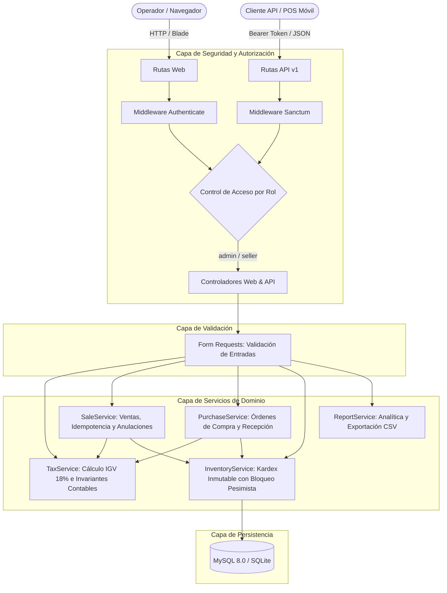

# PymeFlow ERP — Sistema de Gestión Comercial e Inventario para PYMEs (Perú)

[](https://www.php.net/)
[](https://laravel.com/)
[](https://www.mysql.com/)
[](https://tailwindcss.com/)
[](https://phpunit.de/)
[](LICENSE)

**PymeFlow ERP** es una aplicación web Full Stack diseñada para pequeñas y medianas empresas comerciales en el **Perú**. Integra catálogo de productos con afectación tributaria (**Gravado 18%, Exonerado 0%, Inafecto 0%**), Kardex inmutable de inventario, órdenes de compra con recepción de mercadería en almacén, directorio de clientes y proveedores (**RUC / DNI / CE / Pasaporte**), punto de venta (POS) interactivo en **Soles (`S/` / `PEN`)**, anulación de ventas con reversión protegida de stock, reportes gerenciales y una API RESTful v1 autenticada con Laravel Sanctum.

> **Alcance Fiscal Transparente**: PymeFlow ERP gestiona la lógica comercial y el desglose tributario peruano (**IGV 18%**, operaciones gravadas, exoneradas e inafectas) emitiendo **Comprobantes Internos de Venta y Órdenes de Compra**. El sistema **no** declara integración directa con OSE/SUNAT, firma digital XML UBL 2.1 ni emisión de Comprobantes de Pago Electrónicos (CPE) oficiales.

---

## Arquitectura del Sistema

El sistema implementa una arquitectura por capas desacoplada siguiendo el patrón **Service Layer** sobre Laravel 11:



### Decisiones Técnicas Defendibles en Entrevista:
1. **Motor Tributario Peruano Centralizado (`TaxService`)**:
   - Soporta moneda **Sol Peruano (`PEN` / `S/`)** y tasa general de **IGV (18%)** configurable en `config/erp.php`.
   - Soporta las 3 afectaciones de uso común en PYMEs peruanas: **`gravado`** (18%), **`exonerado`** (0%) e **`inafecto`** (0%).
   - Soporta tanto **precios con IGV incluido** (`prices_include_tax = true`, estándar minorista en Perú: `Base = round(Total / 1.18, 2)`, `IGV = Total - Base`) como **precios más IGV** (`prices_include_tax = false`: `IGV = round(Base * 0.18, 2)`, `Total = Base + IGV`).
   - Garantiza la invariante contable estricta en cada línea y cabecera: `tax_base + tax_amount == line_total` y `subtotal + tax == total` usando redondeo `PHP_ROUND_HALF_UP` a 2 decimales.
   - Guarda una **instantánea histórica (`snapshot`)** de `tax_type`, `tax_rate`, `unit_value`, `tax_base`, `tax_amount` y `line_total` en `sale_items` y `purchase_items`, de modo que cambios futuros de precios o tasas no alteren comprobantes históricos.
2. **Transacciones Atómicas, Ordenamiento de Bloqueos (`lockForUpdate`) e Idempotencia**:
   - `SaleService` e `InventoryService` ejecutan cada operación dentro de `DB::transaction()`.
   - Antes de bloquear filas con `Product::whereIn('id', $ids)->orderBy('id')->lockForUpdate()`, los IDs de productos se ordenan ascendentemente para **prevenir interbloqueos (*deadlocks*)** en ventas concurrentes con múltiples ítems.
   - Soporta clave de idempotencia (`idempotency_key`) para evitar ventas duplicadas ante doble clic en el POS o reintentos de red en la API.
3. **Anulación de Ventas con Protección contra Doble Reversión (`cancelSale`)**:
   - Permite a un administrador anular una venta completada registrando motivo obligatorio, usuario y fecha/hora (`cancelled_at`, `cancelled_by`, `cancellation_reason`).
   - Revierte automáticamente las unidades al almacén generando un movimiento en el Kardex con `reference_type = 'SaleCancellation'` y bloquea la venta con `lockForUpdate()` para impedir que una segunda solicitud duplique la devolución de stock.
4. **Separación entre Orden de Compra y Recepción de Mercadería (`PurchaseService`)**:
   - Una orden de compra creada en estado `ordered` (**Pendiente de Recepción**) registra el compromiso con el proveedor pero **no altera el stock físico**.
   - Solo al confirmar la recepción física (`receivePurchase` -> estado `received`) se incrementa el stock en el Kardex (`reference_type = 'Purchase'`) y se actualiza el costo unitario del producto.
5. **Seeders 100% Idempotentes**:
   - `DatabaseSeeder` utiliza `updateOrCreate` e invoca `SaleService` y `PurchaseService` con claves determinísticas, permitiendo ejecutar `php artisan db:seed` repetidamente sin duplicar ventas, compras ni inflar artificialmente el inventario.

---

## Ejemplo Numérico del Cálculo Tributario (`TaxService`)

Supongamos una venta mixta con **precios que incluyen IGV (`prices_include_tax = true`)**:
- **Ítem 1 (Gravado 18%)**: 2 unidades de *Monitor LED 24"* a precio de catálogo `S/ 118.00` c/u:
  - Total línea (`line_total`): `2 × S/ 118.00 = S/ 236.00`
  - Base imponible (`tax_base`): `round(236.00 / 1.18, 2) = S/ 200.00`
  - IGV 18% (`tax_amount`): `236.00 - 200.00 = S/ 36.00`
- **Ítem 2 (Exonerado 0%)**: 2 unidades de *Manual Contable Tributario* a `S/ 50.00` c/u:
  - Total línea (`line_total`): `2 × S/ 50.00 = S/ 100.00`
  - Base exonerada (`tax_base`): `S/ 100.00`
  - IGV (`tax_amount`): `S/ 0.00`
- **Resumen en Cabecera (`Sale`)**:
  - `taxable_amount` (Op. Gravada): `S/ 200.00`
  - `exempt_amount` (Op. Exonerada): `S/ 100.00`
  - `subtotal` (Valor Venta sin IGV): `S/ 300.00`
  - `tax` (IGV 18%): `S/ 36.00`
  - `total` (Importe Total): `S/ 336.00` (`300.00 + 36.00 = 336.00`)

---

## Instalación y Puesta en Marcha

### Requisitos Previos
* PHP 8.2 o superior
* Composer 2.x
* Node.js 18+ y npm
* MySQL 8.0 o SQLite

### Ejecución Local
```bash
# 1. Instalar dependencias
composer install
npm install

# 2. Configurar variables de entorno
cp .env.example .env
php artisan key:generate

# 3. Ejecutar migraciones y datos de demostración (Perú)
php artisan migrate:fresh --seed

# 4. Compilar assets frontend (Vite + Tailwind CSS)
npm run build

# 5. Iniciar servidor local
php artisan serve
```

---

## Credenciales de Demostración

| Rol | Correo Electrónico | Contraseña | Permisos |
| :--- | :--- | :--- | :--- |
| **Administrador** | `admin@pymeflow.com` | `password` | **Acceso Total**: Catálogo, Categorías, Proveedores, Órdenes de Compra, Recepción de Mercadería, Kardex, Anulación de Ventas y Reportes |
| **Vendedora** | `vendedor@pymeflow.com` | `password` | **Operación Comercial**: Dashboard, Punto de Venta (POS), Historial de Ventas, Clientes y Consulta de Catálogo |

---

## Suite de Pruebas Automatizadas (PHPUnit)

Ejecuta la suite completa con:

```bash
php artisan test
```

### Cobertura Actual (`37 passed, 176 assertions`):
- **`PeruTaxAndSaleIntegrityTest`**:
  - Venta con productos gravados e IGV incluido (`18%`).
  - Venta con productos gravados e IGV excluido (`+18%`).
  - Venta mixta con productos `gravado`, `exonerado` e `inafecto`.
  - Redondeo financiero multi-ítem preservando la invariante `subtotal + tax == total`.
  - Protección contra manipulación de precios desde el cliente (`unit_price` alterado en el request es ignorado por el servidor).
  - Prevención de ventas duplicadas mediante `idempotency_key`.
  - Anulación de venta con retorno de stock al Kardex y bloqueo de doble anulación.
- **`PurchaseAndSeederTest`**:
  - Separación entre orden de compra (`ordered`) y recepción de mercadería (`received`), verificando que el stock solo sube al recepcionar y bloqueando doble recepción.
  - Idempotencia de `DatabaseSeeder` al ejecutar `db:seed` múltiples veces seguidas.
  - Restricciones de autorización por rol (`seller` recibe `403 Forbidden` al intentar anular ventas o acceder a compras).
- **`SaleTransactionTest`**, **`ProductValidationTest`**, **`AuthorizationTest`**, **`AuthTest`**, **`ApiV1Test`**.

---

## Licencia
Este proyecto está disponible bajo la licencia [MIT](LICENSE).
