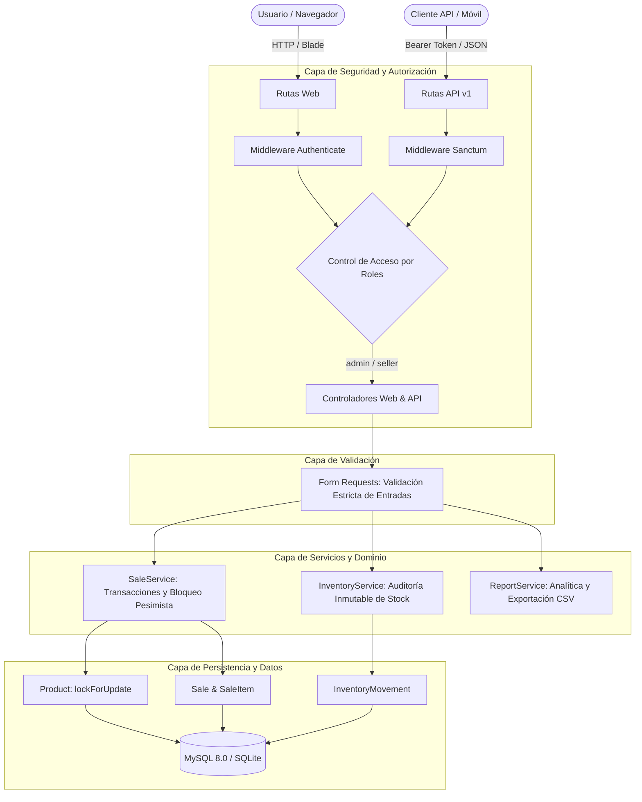

# 💼 PymeFlow ERP — Sistema de Gestión Empresarial para PYMEs

[](https://www.php.net/)
[](https://laravel.com/)
[](https://www.mysql.com/)
[](https://tailwindcss.com/)
[](https://phpunit.de/)
[](LICENSE)

**PymeFlow ERP** es una solución web Full Stack robusta, moderna y de nivel de producción diseñada para pequeñas y medianas empresas. Integra en un solo entorno el catálogo de productos con control de márgenes, auditoría inmutable de inventario, directorio de clientes y proveedores, punto de venta (POS) interactivo con transacciones atómicas seguras, dashboard con KPIs en tiempo real, exportación de reportes a CSV y una API RESTful v1 versionada protegida con Laravel Sanctum.

---

## 🏛️ Arquitectura del Sistema

El sistema implementa una arquitectura por capas desacoplada siguiendo principios **SOLID**, **Clean Code** y el patrón **Service Layer** sobre el framework Laravel:



### Principales Decisiones de Arquitectura:
1. **Transacciones Atómicas y Bloqueo Pesimista (`lockForUpdate`)**: El procesamiento de ventas en `SaleService` adquiere bloqueos pesimistas sobre los registros de productos en la base de datos para prevenir condiciones de carrera (*race conditions*) y sobreventas en entornos de alta concurrencia.
2. **Cálculo Estricto en el Servidor**: El servidor ignora deliberadamente precios o subtotales enviados desde el navegador; todos los valores monetarios se extraen de la base de datos y se calculan en el backend con redondeos financieros seguros.
3. **Auditoría Inmutable de Stock**: Los usuarios no pueden modificar directamente la columna `stock` de los productos. Toda alteración de existencias pasa por `InventoryService`, generando un registro histórico inmutable con stock previo, variación, nuevo stock, motivo y usuario responsable.
4. **Protección Multicapa por Rol**: Control de autorización estricto mediante middleware `EnsureUserHasRole` tanto en interfaz web como en endpoints API, impidiendo que un vendedor acceda a finanzas o configuración manipulando URLs o peticiones HTTP.

---

## ✨ Funcionalidades Principales

### 1. 📊 Dashboard Analítico en Tiempo Real
* **KPIs calculados al instante**: Ventas del día, ventas del mes, productos activos y alertas de stock bajo.
* **Gráfico dinámico**: Evolución de ventas de los últimos 7 días.
* **Alertas de stock crítico**: Detección automática de artículos que alcanzaron su umbral mínimo.
* **Top de productos**: Ranking por volumen de unidades vendidas y recaudación.

### 2. 🛒 Punto de Venta (POS) Interactivo
* Carrito de compras interactivo con validación visual de stock máximo en tiempo real.
* Selección de cliente frecuente o registro de venta a **Cliente Ocasional**.
* Múltiples medios de pago: Efectivo, Tarjeta y Transferencia.
* Emisión inmediata de **Comprobante Interno de Venta (Ticket)** con vista de impresión optimizada (`@media print`).

### 3. 📦 Catálogo de Productos y Categorías
* Código **SKU único e indexado**.
* Validación de margen comercial (el precio de venta no puede ser inferior al costo).
* Control de stock actual y stock mínimo para alertas tempranas.
* Integridad referencial: Bloqueo de eliminación para categorías con productos asociados.

### 4. 📋 Auditoría y Movimientos de Inventario
* Tipos de movimiento: **Entradas (+)**, **Salidas (-)** y **Ajustes Físicos**.
* Prevención estricta de stock negativo.
* Historial con trazabilidad completa: fecha, producto, usuario responsable y justificación.

### 5. 👥 Clientes y Proveedores
* Directorio comercial con búsqueda por nombre, identificación fiscal (DNI, RUT, RFC), correo o teléfono.
* Historial de órdenes de compra vinculadas a cada cliente.

### 6. 📈 Reportes y Exportación CSV
* Filtro de ventas por rango de fechas y clientes.
* Exportación de **Reporte de Ventas en CSV** compatible con Excel (BOM UTF-8).
* Exportación de **Reporte de Inventario y Valoración de Stock en CSV**.

### 7. 🔌 API RESTful v1 (`/api/v1`)
* Autenticación basada en tokens personales con **Laravel Sanctum**.
* Endpoints para productos, clientes, ventas, inventario y métricas.
* Respuestas JSON normalizadas con códigos HTTP semánticos (`200`, `201`, `401`, `403`, `404`, `422`).

---

## 🛠️ Stack Tecnológico

| Capa | Tecnología | Propósito |
| :--- | :--- | :--- |
| **Backend** | PHP 8.2 / 8.3 | Lenguaje de servidor con tipado estricto |
| **Framework** | Laravel 11.x | Arquitectura MVC, Eloquent ORM, Validaciones |
| **Seguridad** | Laravel Sanctum | Autenticación basada en Bearer Tokens para API |
| **Frontend** | Blade + Tailwind CSS 3.4 | Vistas responsivas con diseño SaaS profesional |
| **Compilador** | Vite 5.x | Compilación y optimización de recursos frontend |
| **Bases de Datos** | MySQL 8.0 & SQLite | Motor relacional con soporte dual |
| **Pruebas** | PHPUnit 10.x | Pruebas de integración, validación y transacciones |
| **Contenedores** | Docker Compose | Entorno reproducible con Nginx, PHP y MySQL |

---

## 🚀 Instalación y Puesta en Marcha

### Requisitos Previos
* PHP 8.2 o superior con extensiones `pdo`, `mbstring`, `openssl`, `curl`.
* Composer 2.x
* Node.js 18+ y npm
* MySQL 8.0 (opcional, SQLite soportado por defecto sin configuración)

---

### Opción A: Ejecución Local Rápida (Recomendada)

1. **Clonar el repositorio**:
   ```bash
   git clone https://github.com/tu-usuario/pymeflow-erp.git
   cd pymeflow-erp
   ```

2. **Instalar dependencias de PHP y Node**:
   ```bash
   composer install
   npm install
   ```

3. **Configurar el entorno**:
   ```bash
   cp .env.example .env
   php artisan key:generate
   ```

4. **Ejecutar migraciones y cargar datos de demostración**:
   ```bash
   php artisan migrate:fresh --seed
   ```

5. **Compilar recursos frontend**:
   ```bash
   npm run build
   ```

6. **Iniciar el servidor de desarrollo**:
   ```bash
   php artisan serve
   ```
   Accede en tu navegador a: **`http://127.0.0.1:8000`**

---

### Opción B: Ejecución con Docker Compose

El proyecto incluye configuración completa de Docker con Nginx, PHP 8.2-FPM y MySQL 8.0:

```bash
# 1. Levantar los contenedores
docker compose up -d --build

# 2. Ejecutar migraciones con seeders en el contenedor
docker compose exec app php artisan migrate:fresh --seed

# 3. Compilar frontend (si es necesario)
docker compose exec app npm run build
```

* **Aplicación Web**: `http://localhost:8000`
* **phpMyAdmin**: `http://localhost:8080` (Usuario: `root`, Contraseña: `root`)

---

## 🔑 Credenciales de Demostración

Para explorar los distintos roles del sistema, se incluyen usuarios precargados en el seeder:

| Rol | Correo Electrónico | Contraseña | Permisos |
| :--- | :--- | :--- | :--- |
| **Administrador** | `admin@pymeflow.com` | `password` | **Acceso Total**: Catálogo, Precios, Categorías, Proveedores, Reportes, Ajustes de Stock |
| **Vendedora** | `vendedor@pymeflow.com` | `password` | **Comercial**: Dashboard, Punto de Venta (POS), Historial de Ventas, Clientes, Catálogo (Lectura) |

> 💡 *En la pantalla de inicio de sesión (`/login`) encontrarás botones de acceso rápido que rellenan automáticamente estas credenciales para facilitar la evaluación.*

---

## 🧪 Pruebas Automatizadas

El proyecto cuenta con una suite de pruebas exhaustiva que valida los flujos críticos del negocio:

```bash
php artisan test
```

### Resultados de la Suite de Pruebas:
```text
   PASS  Tests\Unit\ExampleTest
  ✓ that true is true

   PASS  Tests\Feature\AuthTest
  ✓ unauthenticated user is redirected from dashboard
  ✓ user can view login screen
  ✓ user can authenticate with valid credentials
  ✓ user cannot authenticate with invalid password
  ✓ inactive user cannot authenticate

   PASS  Tests\Feature\AuthorizationTest
  ✓ seller cannot access categories management
  ✓ seller cannot access suppliers management
  ✓ seller cannot access manual inventory adjustments
  ✓ seller cannot access financial reports
  ✓ seller can access dashboard and pos
  ✓ admin has full access to all modules

   PASS  Tests\Feature\ProductValidationTest
  ✓ duplicate sku is rejected
  ✓ sale price cannot be less than cost price
  ✓ valid product creation audits initial stock

   PASS  Tests\Feature\SaleTransactionTest
  ✓ valid sale registers sale header items and decrements stock
  ✓ sale with insufficient stock is rejected
  ✓ failed sale rolls back entire transaction atomically
  ✓ server calculates totals ignoring tampered client data

   PASS  Tests\Feature\ApiV1Test
  ✓ unauthenticated request is rejected
  ✓ api login returns sanctum token
  ✓ authenticated user can list products
  ✓ seller cannot create products via api
  ✓ admin can create product via api
  ✓ create sale via api v1 decrements stock
  ✓ dashboard metrics endpoint returns data

  Tests:    27 passed (104 assertions)
  Duration: 1.50s
```

---

## 📡 Documentación de la API RESTful (`/api/v1`)

Todos los endpoints (excepto el login) requieren el encabezado `Authorization: Bearer <TOKEN>`.

### 1. Autenticación
* **POST `/api/v1/auth/login`**:
  ```json
  {
    "email": "admin@pymeflow.com",
    "password": "password"
  }
  ```
  **Respuesta (200 OK)**:
  ```json
  {
    "success": true,
    "message": "Autenticación exitosa.",
    "data": {
      "user": { "id": 1, "name": "Carlos Mendoza", "role": "admin" },
      "token": "1|qXy...78z",
      "token_type": "Bearer"
    }
  }
  ```

### 2. Catálogo de Productos
* **GET `/api/v1/products`**: Lista paginada con filtros `search`, `category_id` y `low_stock`.
* **GET `/api/v1/products/{id}`**: Detalle de producto con su categoría.
* **POST `/api/v1/products`** *(Admin)*: Crear producto con auditoría de inventario inicial.
* **PUT `/api/v1/products/{id}`** *(Admin)*: Actualizar producto.

### 3. Registro de Ventas
* **POST `/api/v1/sales`**:
  ```json
  {
    "customer_id": 1,
    "payment_method": "efectivo",
    "items": [
      { "product_id": 1, "quantity": 2 },
      { "product_id": 2, "quantity": 1 }
    ]
  }
  ```
  **Respuesta (201 Created)**: Retorna la venta con consecutivo generado (`VEN-YYYYMM-XXXX`), cálculo de totales e inventario descontado.

### 4. Analítica y Métricas
* **GET `/api/v1/dashboard/metrics`**: Indicadores consolidados del dashboard y evolución semanal.

---

## 🎯 Puntos Clave para Presentar en una Entrevista Técnica

Si utilizas este proyecto para una entrevista técnica de desarrollo Full Stack o Backend:
1. **Transaccionalidad en Ventas**: Destaca cómo se utilizó `DB::transaction()` junto a `Product::lockForUpdate()` para garantizar que dos cajeros no puedan vender la última unidad al mismo tiempo.
2. **Cálculo Seguro en Servidor**: Explica que el cliente web o móvil solo envía `product_id` y `quantity`. El servidor busca los precios vigentes en la base de datos para prevenir alteraciones maliciosas.
3. **Auditoría Inmutable**: Resalta que no existe un `UPDATE stock = X` libre. Cualquier modificación genera un `InventoryMovement` auditable.
4. **Separación de Responsabilidades**: Menciona la división limpia entre Form Requests (validación), Controladores (orquestación HTTP) y Servicios de Dominio (lógica de negocio).
5. **Cobertura con Pruebas**: Demuestra cómo los 27 tests automatizados verifican desde permisos 403 hasta rollbacks transaccionales.

---

## 📄 Licencia
Este proyecto es de código abierto y está disponible bajo la licencia [MIT](LICENSE).
